# Spotify Trackerr

Self-hosted Spotify listening history, stats, and music discovery for you and a few friends.
See your top songs, albums, artists, and genres; explore how your listening changes over time;
and revisit any year's music. New plays sync from Spotify every 5 to 30 minutes (your pick), and Spotify's
extended streaming history export fills in the past.

YouTube Music listening comes in too: let the server pull it from Google once a day, import its
history from Google Takeout, or count your Last.fm or ListenBrainz scrobbles as plays. Optional Last.fm and ListenBrainz
connections also help Discover pick new music from more of your listening. Your dashboards and
history use the plays synced or imported into this app.

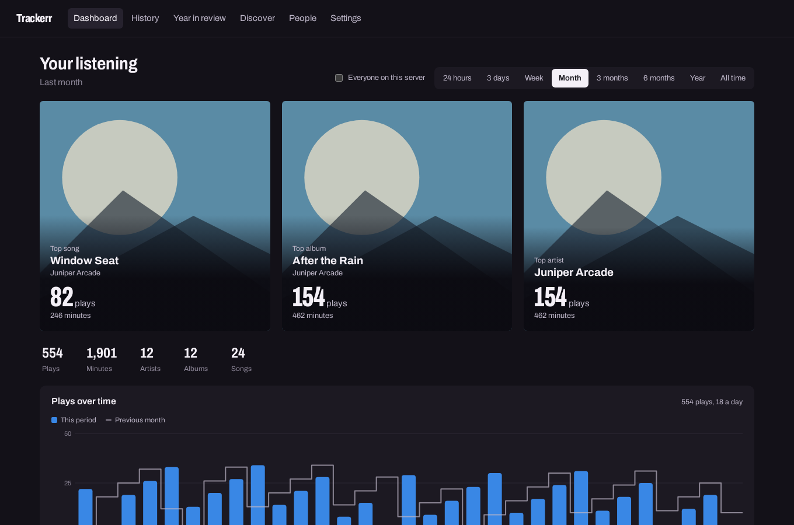

Screenshots show the current app with fictional artists, artwork, listening history, and
recommendation picks. No personal listening data or real connected accounts are shown.

## What you can do

- **Explore your listening.** Rank songs, albums, and artists by plays or minutes, from the last
  24 hours to all time. See trends, listening hours, genres, release decades, and album artwork.
  Choose minutes, hours, days, or months as the listening-time display unit in Settings.
- **Dig into a genre.** Click a genre on the dashboard or Year in Review to see its top song,
  album, and artist, plus top 10 lists for each. Keep the dashboard's time range or review year.
- **Search your history.** Search-as-you-type suggests songs, albums, and artists. Filter plays
  by date or month, and open a song, album, or artist to see its totals, first and last plays,
  monthly listening, and peak listening period.
- **Revisit a year.** Year in Review includes top fives, listening totals, a daily calendar,
  monthly charts, genres, and release years. It now lists your top 10 artists first heard that
  year and shows your biggest and quietest listening days. Quietest means the fewest plays on
  a day when you listened; days with no plays are excluded. “New to you” is based on the history
  stored here.
- **Get a monthly or yearly report.** Reports opens on this year and compares any calendar month
  or year with the one before it (a period still under way is compared with the same stretch of
  the one before). *Download PDF* saves it as a printable report: totals, the busiest day, plays
  over the period, when you listen, and top artists, songs, albums and genres.
- **Share a report with friends.** *Share with friends* publishes a copy of one Report at a link
  anyone can open without signing in: totals, top lists, charts and your top 10 new artists, never
  your play history. *Update* refreshes the copy and keeps the link; *Stop sharing* breaks it.
  Friends need a public address to open it, so set up the Cloudflare Tunnel and put its hostname
  in `SHARE_URL`.
- **Find new music.** Discover offers artists, albums, and songs you haven't played in the app's
  recorded history, using Last.fm recommendations. Connect Last.fm or ListenBrainz in Settings
  to use your top artists and songs from those services; otherwise it uses your local history.
  Last.fm is preferred, with ListenBrainz and local history as fallbacks when needed.
- **Hear when artists you love play near you.** Choose *Watch for shows* on an artist's page, set
  where you live and how far you'd travel on the Shows page, then connect an AI assistant (Claude
  or any MCP app) in Settings → AI assistant. The assistant reads your watched artists, searches
  for their concerts near you, and saves what it finds to Shows. New shows get a badge in the menu,
  and the assistant tells you only about shows it hasn't reported before.
- **Ban what you don't want to see.** Ban a song, album, or artist from its page and it
  disappears from your stats, top lists, charts, history, search, and recommendations. The plays
  stay saved: unban it from the page or from Settings → Banned and everything comes back.
- **Share with people on your server.** Make your listening visible to other signed-in users,
  browse their dashboards and histories through People, or view everyone's shared listening
  together. Visibility is controlled in Settings.
- **Track YouTube Music.** Let the server pull your YouTube Music plays from Google every day,
  import your history from Google Takeout, or count the scrobbles a scrobbler sends to Last.fm or
  ListenBrainz as plays. See [YouTube Music](#youtube-music).
- **Manage your connections.** Settings has separate sections for Spotify, your own Spotify
  app, Google, Last.fm, ListenBrainz, and YouTube Music, alongside history import, preferences,
  and account controls.

Recent updates also improve all-time and year dashboard performance, handle Spotify rate limits
with a pause per developer app, and add automated build, browser, and security checks.

## Screenshots

<details>
<summary>Genre pages: top song, album, artist, and top 10 lists</summary>

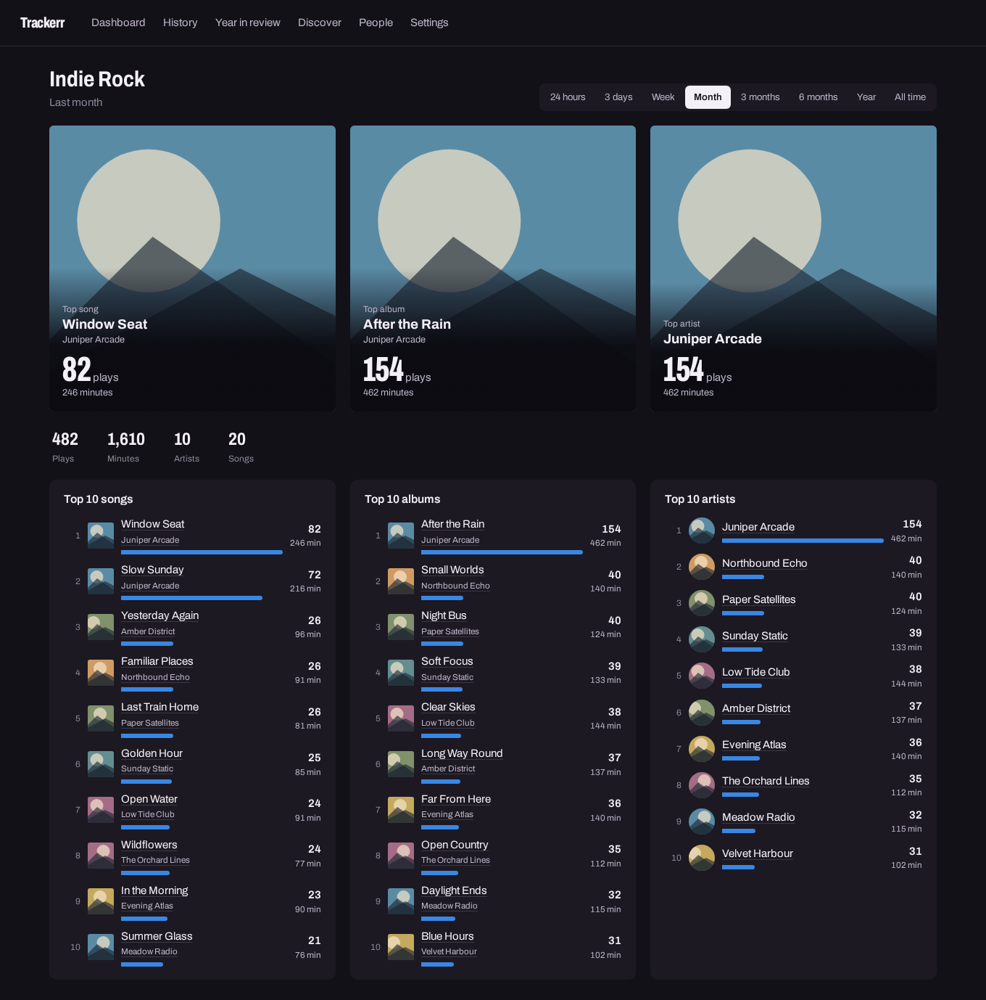

</details>

<details>
<summary>Reports: a month compared with the one before, and its PDF</summary>

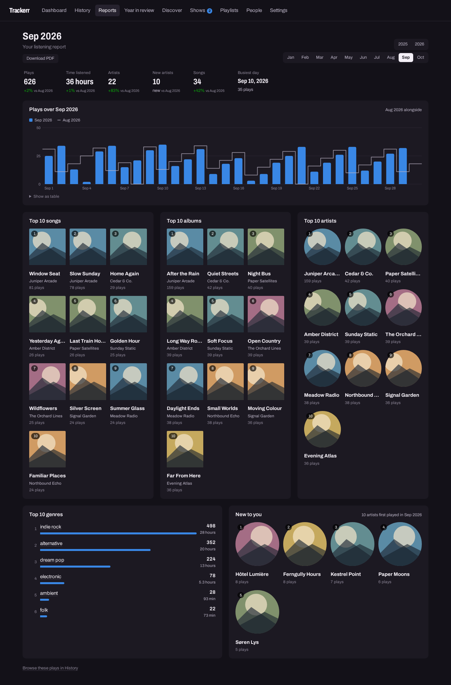

The downloaded PDF: [overview](docs/screenshots/report-pdf-1.png),
[top lists](docs/screenshots/report-pdf-2.png),
or [the PDF itself](docs/screenshots/listening-report-2026-09.pdf).

</details>

<details>
<summary>A shared Report: what a friend sees from its link, without signing in</summary>

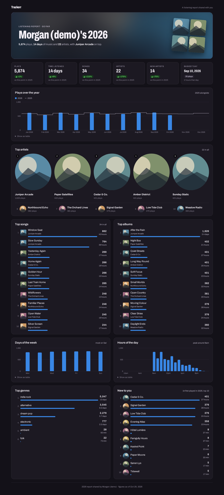

</details>

<details>
<summary>Year in Review: artists new to you, biggest day, and quietest listening day</summary>

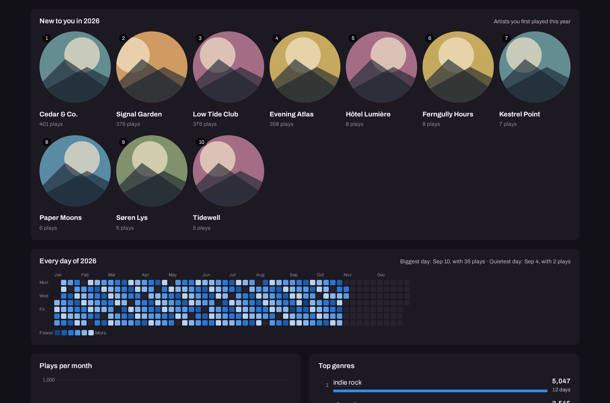

[See the full Year in Review](docs/screenshots/year-in-review.png).

</details>

<details>
<summary>Discover: artist, album, and song recommendations</summary>

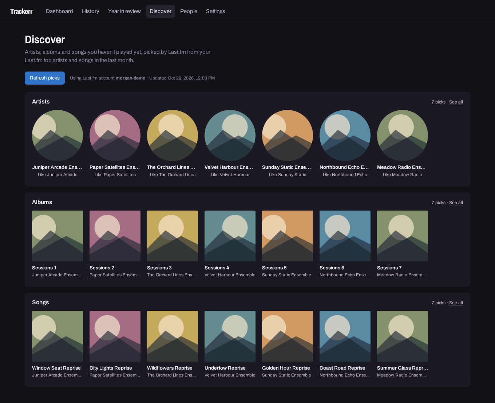

</details>

<details>
<summary>Listening history and individual music pages</summary>

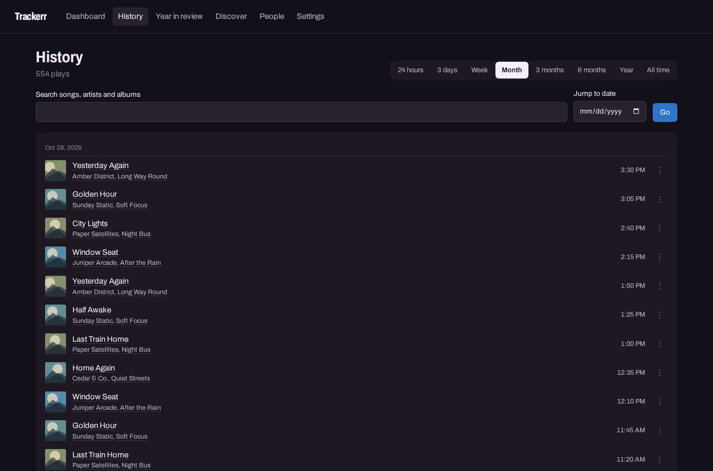

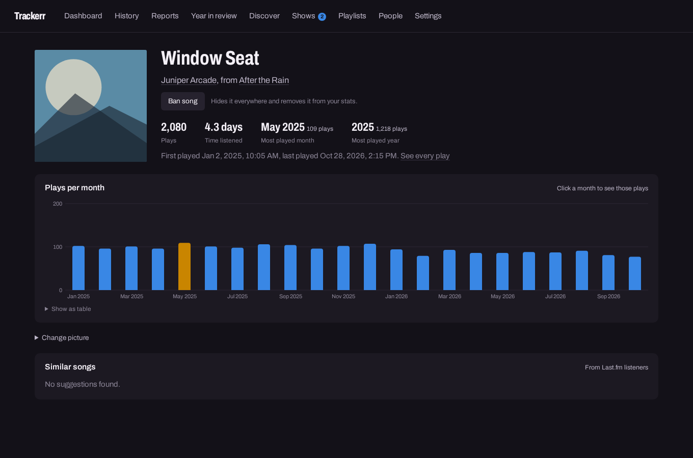

See the [artist](docs/screenshots/artist.png), [album](docs/screenshots/album.png), and
[top artists](docs/screenshots/top-artists.png) pages too.

</details>

<details>
<summary>Shows: watched artists, your home, and concerts an AI assistant found near you</summary>

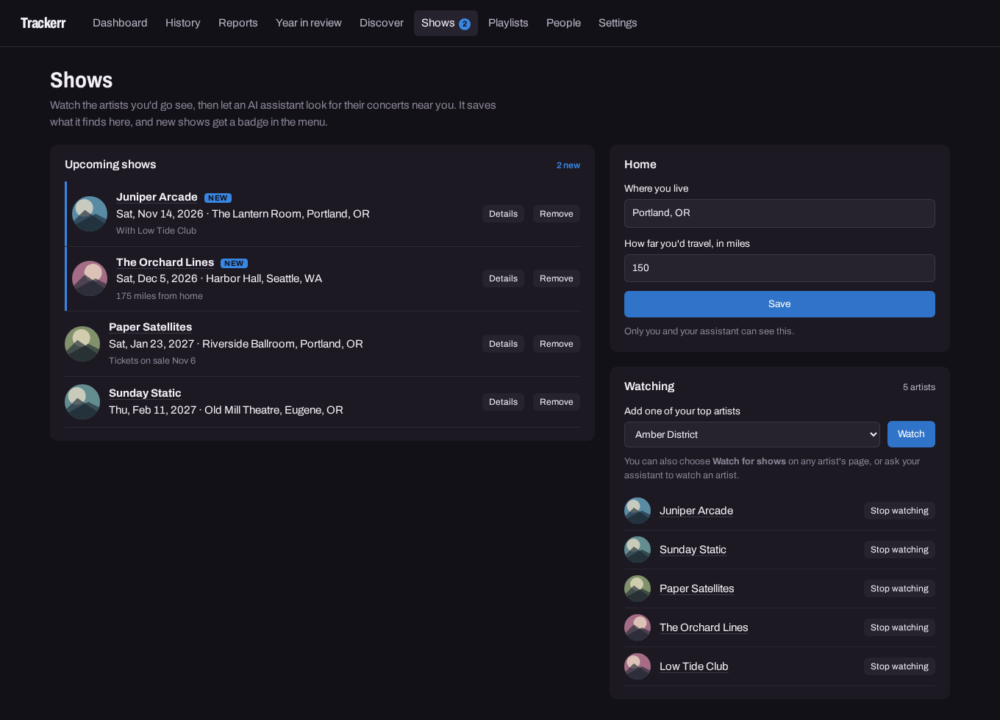

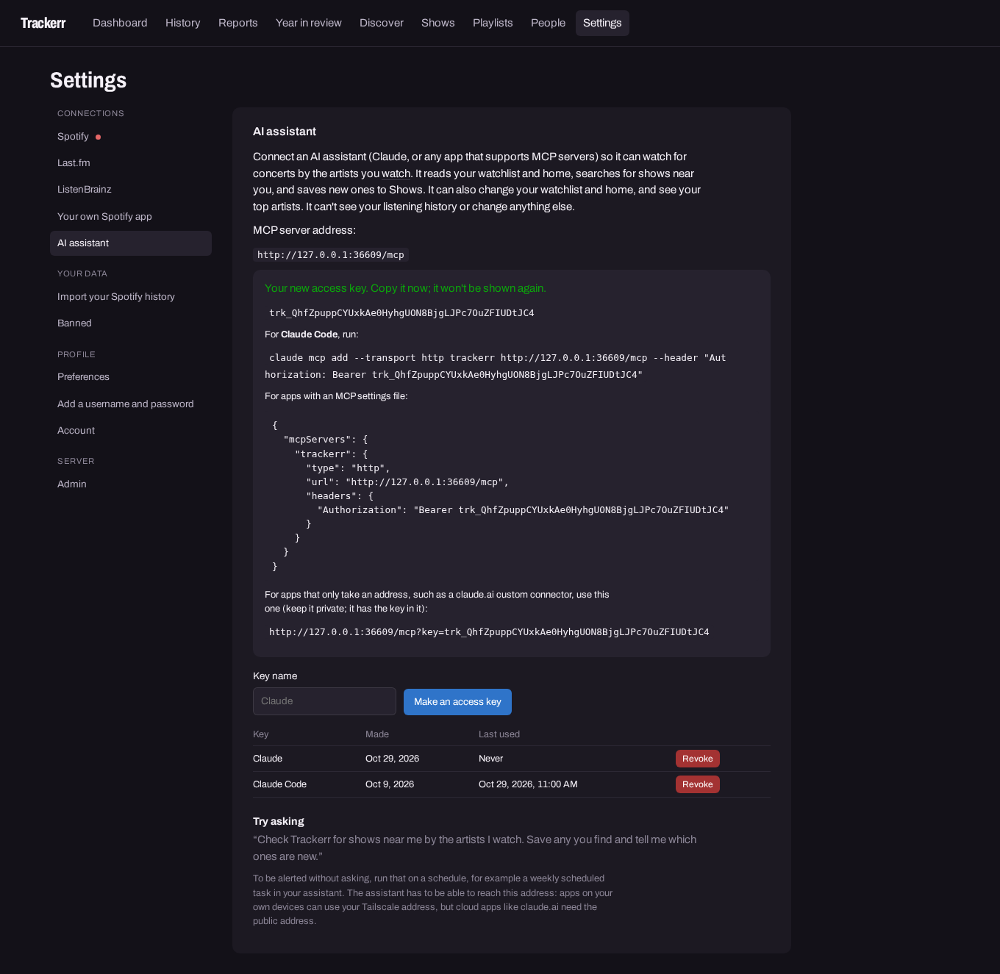

</details>

<details>
<summary>Settings: Spotify sync interval and Sync now</summary>

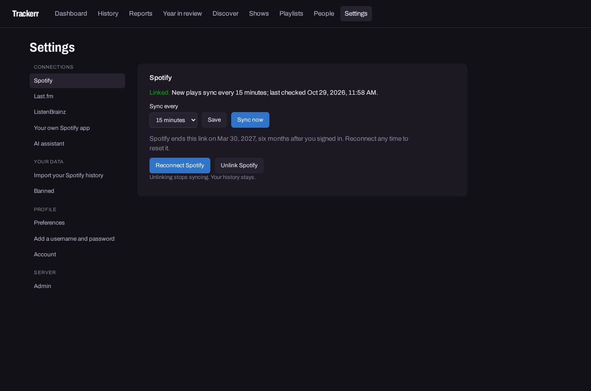

</details>

<details>
<summary>Settings: Last.fm and ListenBrainz connections</summary>

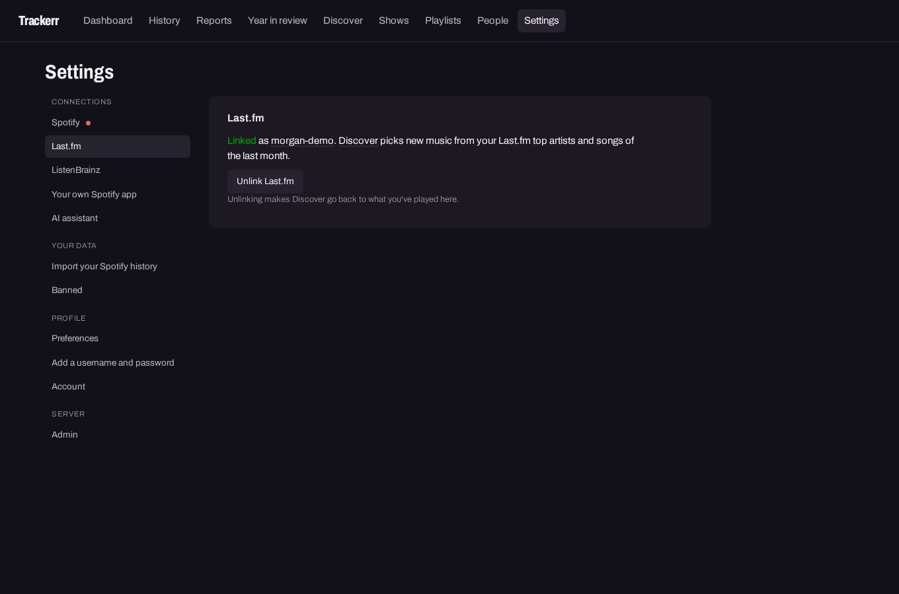

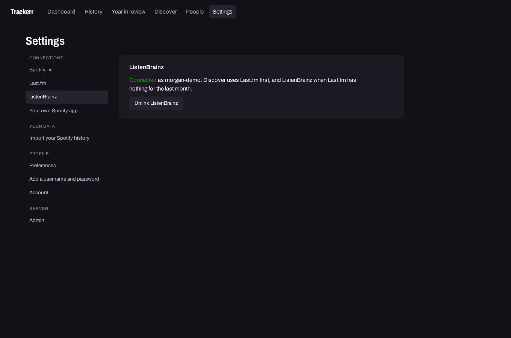

</details>

<details>
<summary>Preferences: rankings, listening-time units, and visibility</summary>

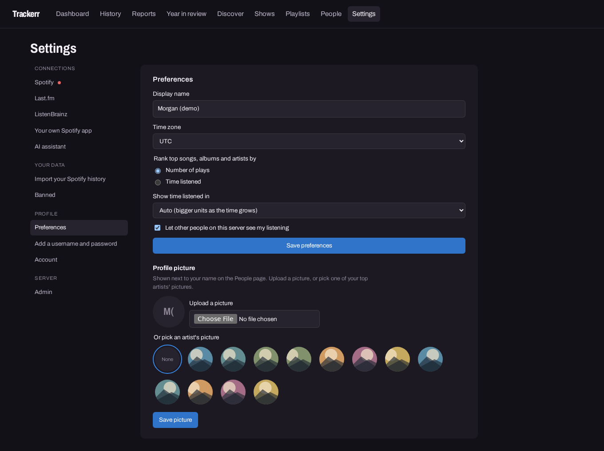

</details>

<details>
<summary>Phone layout</summary>

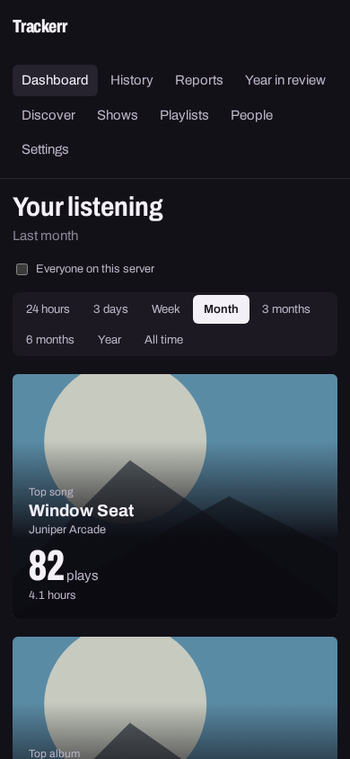

</details>

Also see the [complete dashboard](docs/screenshots/dashboard.png),
[all-time dashboard](docs/screenshots/dashboard-all-time.png), and [People](docs/screenshots/people.png).
To refresh these images, see [the screenshot instructions](docs/screenshots/README.md).

## Run it

```sh
cp .env.example .env      # fill it in (see below)
docker compose up -d --build
tailscale serve --bg --https=8447 http://127.0.0.1:3457
```

Once you have a Cloudflare tunnel token in `.env`, add the tunnel with
`docker compose --profile tunnel up -d`.

Open https://hermes.tail36fb9.ts.net:8447. The first account you create is the admin.

If a device says the name can't be found, its Tailscale DNS is off. Turn on *Use Tailscale DNS* in
its Tailscale app (and switch off Chrome's *Use secure DNS*), or use http://100.100.64.121:8448
(set `TAILSCALE_IP` and add that address to `ALLOWED_HOSTS`). Spotify sign-in only works from the
https name.

## Setup checklist

1. **Spotify app.** At https://developer.spotify.com/dashboard create an app (Web API), add both
   redirect URIs from `.env.example`, and copy the Client ID and secret into `.env`. Your account
   must have Premium. Under *User Management*, add the Spotify accounts of everyone who will use it
   (Spotify allows 5 per app). More people? Each can create their own app and paste it into
   *Settings > Your own Spotify app*.
2. **Cloudflare Tunnel.** Create a tunnel in Cloudflare Zero Trust, give it a public hostname
   that points to `http://app:3000`, and put the token in `CLOUDFLARE_TUNNEL_TOKEN`. Add that
   hostname to `ALLOWED_HOSTS` and as a Spotify redirect URI, and set `SHARE_URL` to it so shared
   Report links work for friends. Then run `docker compose --profile tunnel up -d`.
3. **Last.fm (optional).** Create a free app at https://www.last.fm/api/account/create and paste its
   API key and shared secret into *Settings > Last.fm* as an admin (or put them in `LASTFM_API_KEY`
   and `LASTFM_SHARED_SECRET`, which take priority). That turns on Discover
   (new artists, albums and songs), similar songs/artists and better genres, and lets each person
   *Sign in with Last.fm* in Settings so Discover works from their Last.fm top artists and songs.
   Discover and similar-music recommendations require the Last.fm API key; sign-in also needs
   the shared secret.
4. **ListenBrainz (optional).** For *Sign in with ListenBrainz*, register a web app at https://musicbrainz.org/account/applications
   with callback `https://<your address>/auth/listenbrainz/callback` and put its ID and secret in
   `MUSICBRAINZ_CLIENT_ID` and `MUSICBRAINZ_CLIENT_SECRET`. Each person can then connect their
   MusicBrainz account in *Settings > ListenBrainz*. Discover still requires the Last.fm API key
   to generate recommendations. Connecting either service doesn't add its plays to your history
   unless you turn on *Count scrobbles as plays* in *Settings > YouTube Music*.
5. **AI assistant (optional).** Each person makes an access key in *Settings > AI assistant*, which
   shows the commands to add this app's MCP server (`https://<your address>/mcp`) to Claude Code or
   another MCP app. The assistant must be able to reach that address: local apps can use the
   Tailscale name, but cloud apps such as claude.ai need the Cloudflare Tunnel hostname. Ask it to
   check for shows near you, or run that request on a schedule to get alerts.
6. **Google sign-in (optional).** In the Google Cloud console
   (https://console.cloud.google.com/apis/credentials), create an OAuth client ID of type *Web
   application* with redirect URI `https://<your address>/auth/google/callback`. Paste its client ID
   and secret into *Settings > Google* as an admin (the secret is stored encrypted, and Google checks
   the pair before it's saved), or put them in `GOOGLE_CLIENT_ID` and `GOOGLE_CLIENT_SECRET`, which
   win over Settings. The login page then shows *Sign in with Google* for everyone, and each person
   can link Google in *Settings > Google* without entering any ID or secret of their own. Google sign-in reads no
   listening. A Google account that isn't linked yet creates an account only while sign-up is open.
   For the YouTube Music pull, also turn on the
   [Data Portability API](https://console.cloud.google.com/apis/library/dataportability.googleapis.com)
   in the same project and add the `https://www.googleapis.com/auth/dataportability.myactivity.youtube`
   scope to the OAuth consent screen. That scope is Restricted: until Google verifies the app, only
   the test users listed on the consent screen can connect.
7. **Import history.** Request *Extended streaming history* at https://www.spotify.com/account/privacy/
   and upload the zip in Settings when it arrives (up to 30 days). For YouTube Music, see below.

Spotify ends each link 6 months after sign-in. The app warns two weeks ahead; click
*Reconnect Spotify* to renew.

## YouTube Music

YouTube Music has no live feed of what you play, and signing in with Google doesn't read any. Your
YouTube Music listening comes in up to three ways:

1. **Pulled from Google every day.** When Google sign-in is set up (see step 6 above), click
   *Connect YouTube history* in *Settings > YouTube Music* and allow access on Google's screen.
   This is a separate permission from signing in. Once a day the server asks Google, through its
   Data Portability API, for your YouTube history since the last pull, waits for Google to prepare
   it (minutes to hours), and saves the YouTube Music plays in it. The first pull brings in your
   whole history. Choose access for 30 or 180 days to keep pulling; access for one time pulls once.
   *Stop pulling* removes the server's access at Google.
2. **Your history so far.** At https://takeout.google.com, choose only *YouTube and YouTube
   Music*, include only history, and under *Multiple formats* choose JSON for history. Upload the
   .zip, or the `watch-history.json` inside it, in *Settings > Import your history*. Only YouTube
   Music plays count; other YouTube videos are skipped. The HTML version of the history can't be
   read.
3. **New plays as you listen.** Install a scrobbler that sends what you play to Last.fm or
   ListenBrainz, such as [Web Scrobbler](https://web-scrobbler.com/) in your browser or
   [Pano Scrobbler](https://github.com/kawaiiDango/pano-scrobbler) on Android. Link that account in
   *Settings > Last.fm* or *Settings > ListenBrainz*, then pick it under *Count scrobbles as plays*
   in *Settings > YouTube Music*. The first sync brings in your whole scrobble history; after that,
   new scrobbles are checked on your sync interval. A scrobble of a song you also imported from
   Takeout or synced from Spotify around the same time counts once.

A play that is both pulled from Google and uploaded from Takeout counts once. Pulls, Takeout and
scrobbles don't say how long you listened. Those plays count as the song's full length once its
length is known (from the artwork lookup, ListenBrainz, or Spotify), and as 0 minutes
until then.

## Shows near you

Trackerr can tell you when artists you love are playing near you. The app keeps your list of
watched artists and where you live. An AI assistant that you connect does the searching: it reads
your list over MCP (Model Context Protocol), looks up each artist's tour dates on the web, and
saves the shows it finds back to Trackerr.

```text
You watch artists ──▶ Trackerr ◀──MCP──▶ AI assistant ──▶ web search for tour dates
                         │                    │
                Shows page + badge     tells you about new shows
```

Trackerr doesn't search for concerts on its own, and it doesn't send emails or phone
notifications. You hear about a show in two places:

- **In the assistant.** After each check, it tells you which shows are new. It doesn't repeat shows
  it has already reported.
- **In Trackerr.** New shows get a badge on **Shows** in the menu until you open that page.

### Set it up

1. **Watch some artists.** Open an artist's page and choose **Watch for shows**, or add one of
   your top artists on the **Shows** page. You can watch artists you haven't played yet by asking
   your assistant.
2. **Set your home.** On the **Shows** page, enter where you live (for example, `New Orleans, LA`)
   and how many miles you'd travel. Only you and your assistant can see these.
3. **Make an access key.** Go to **Settings → AI assistant**, name the key (for example,
   `Claude`), and choose **Make an access key**. Copy the key right away; it is shown only once.
4. **Add Trackerr to your assistant.** The Settings page shows ready-to-paste setup for your key:

   - **Claude Code:**

     ```sh
     claude mcp add --transport http trackerr https://<your address>/mcp --header "Authorization: Bearer <your key>"
     ```

   - **Apps with an MCP settings file:** add an HTTP server with the address
     `https://<your address>/mcp` and the header `Authorization: Bearer <your key>`.
   - **Apps that only take an address,** such as a claude.ai custom connector: use
     `https://<your address>/mcp?key=<your key>`. Treat this address like a password.

   Your assistant must be able to reach the address. Apps on your own devices can use your
   Tailscale address. Cloud apps such as claude.ai need the public Cloudflare Tunnel address.

### Use it

Ask your assistant something like:

> Check Trackerr for shows near me by the artists I watch. Save any you find and tell me which
> ones are new.

Other things you can ask:

- "Which of my top artists am I not watching yet? Watch the top five."
- "Start watching Big Thief."
- "I'm moving to Austin, TX. I'll drive up to 200 miles for a show."

To get alerts without asking, schedule that first request to run weekly in your assistant, if it
supports scheduled tasks. Your assistant's own notification settings decide whether you get a
notification when it finishes.

Shows you don't want can be removed from the **Shows** page. Past shows disappear on their own.

### What the assistant can do

| Tool | What it does |
|---|---|
| `get_show_watchlist` | Reads your watched artists, home, travel distance, today's date, and shows already saved. |
| `save_shows` | Saves shows it found and reports which are new, already saved, or rejected. |
| `watch_artist` / `unwatch_artist` | Adds or removes an artist on your watchlist. |
| `set_home` | Changes where you live and how far you'd travel. |
| `top_artists` | Lists your most played artists, so it can suggest who to watch. |

A key works only for the person who made it. It can't read your listening history or change
anything else. Trackerr refuses shows with past or invalid dates, missing venues or cities, and
artists you don't watch. The same artist, date, and city counts as one show, even if the venue is
written differently. Revoke a key in **Settings → AI assistant** to cut off any assistant using it.

### If it doesn't work

- **401 Unauthorized:** the key is wrong or was revoked. Make a new one.
- **421 Misdirected Request:** add the address the assistant uses to `ALLOWED_HOSTS`.
- **The assistant can't connect:** check that it can reach the address from where it runs.
- **No shows found:** the assistant needs web search turned on. Check that your home is set on
  the **Shows** page.

## How it counts

- A Spotify play counts if it lasted 30 seconds or the song finished. Private sessions, podcasts and
  audiobooks are left out. Every YouTube Music play in Takeout counts, and so does every scrobble.
- Re-importing is safe. A play from a different source (Spotify import, Spotify sync, Takeout or
  scrobble) within 3 minutes (or the song's length, if longer) of an existing play is treated as
  the same play.
- Plays credit the song's main artist.
- Artwork comes from Deezer (iTunes as fallback), genres from Spotify then Last.fm, both looked up
  in the background, most-played first.

## Develop

```sh
npm install
npm run dev     # http://127.0.0.1:5173
npm test
npm run check
```

GitHub Actions runs tests, type checks, browser smoke tests, dependency/security scans, and Docker checks.
See [.github/README.md](.github/README.md) for local commands, schedules, and repository settings.

## Data and backups

Data lives in SQLite at `$DATA_DIR/trackerr.db` (`./data` by default, mounted at `/data` in Docker).
Spotify credentials, linked Last.fm session keys, and secrets pasted into Settings are encrypted
with `$DATA_DIR/secret.key`. Back up the key with the database; without it, affected connections
need to be reconnected and saved app credentials entered again. Keep your `.env` configuration
backed up separately.
