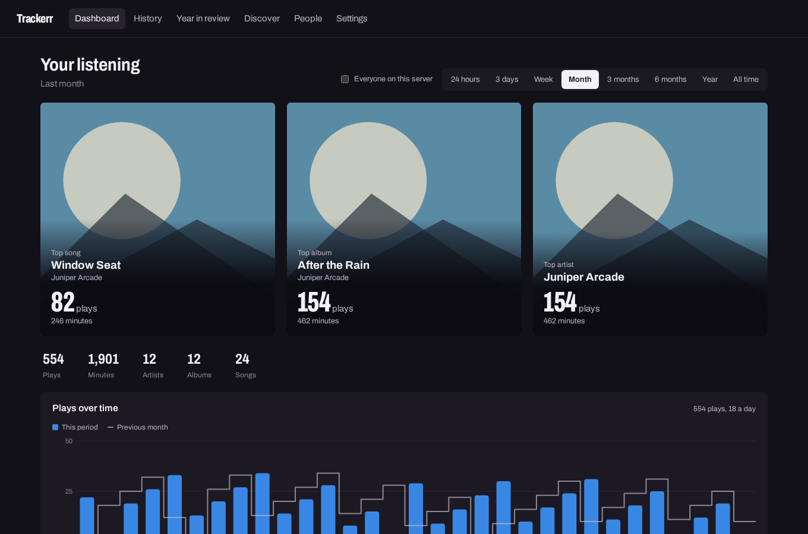
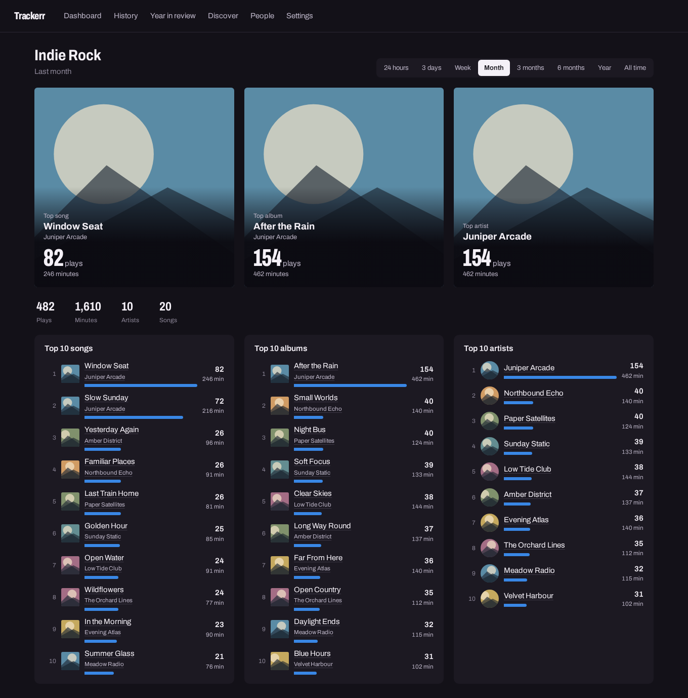
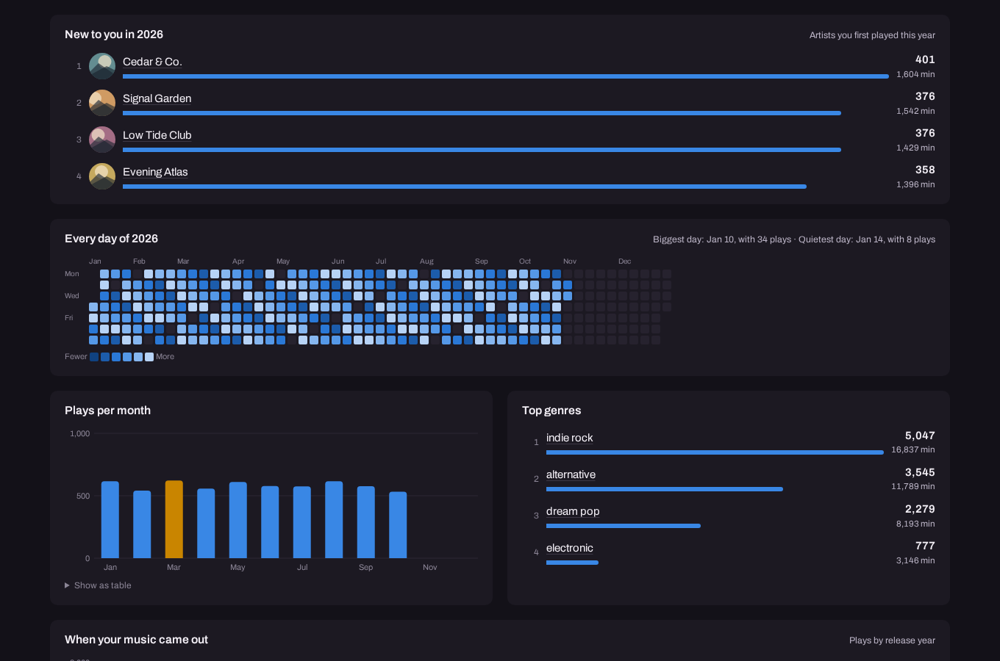
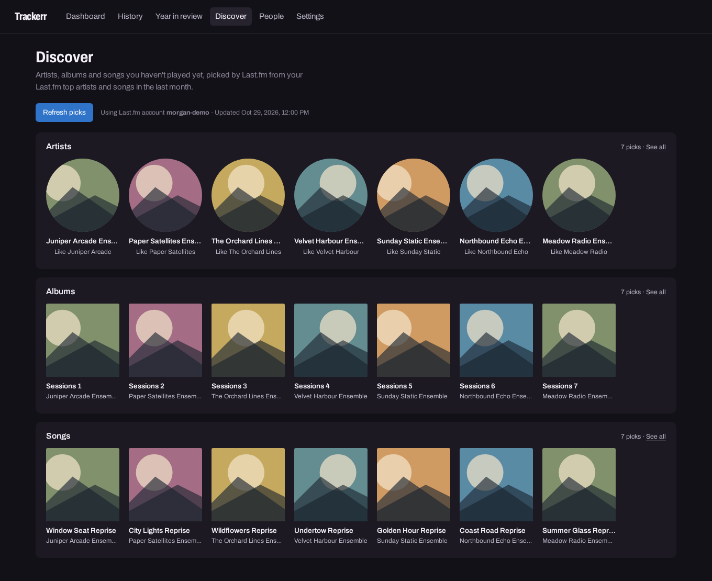
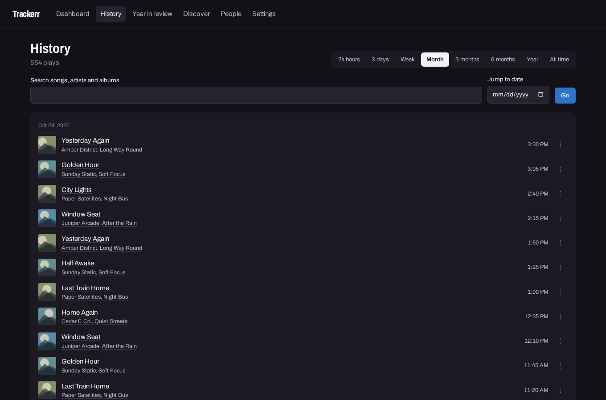
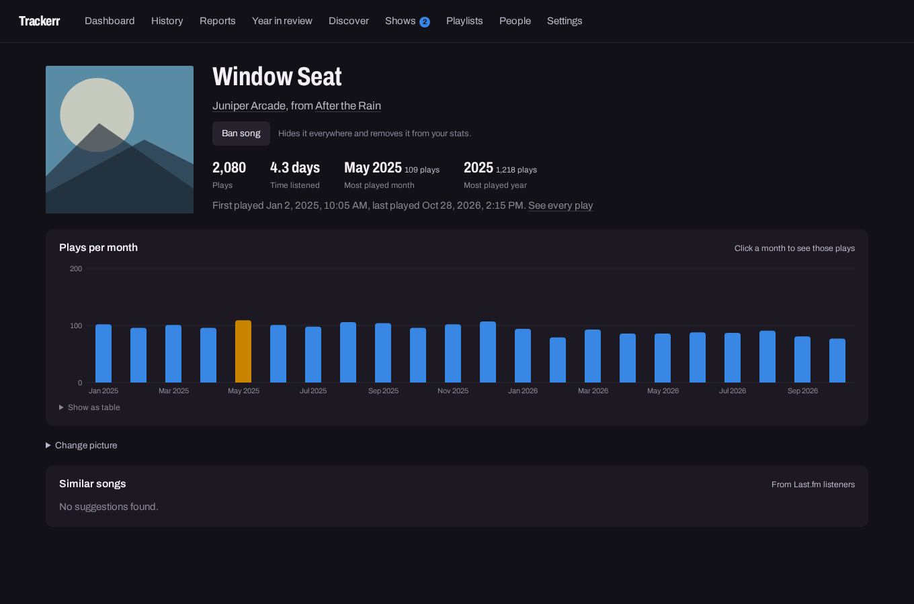
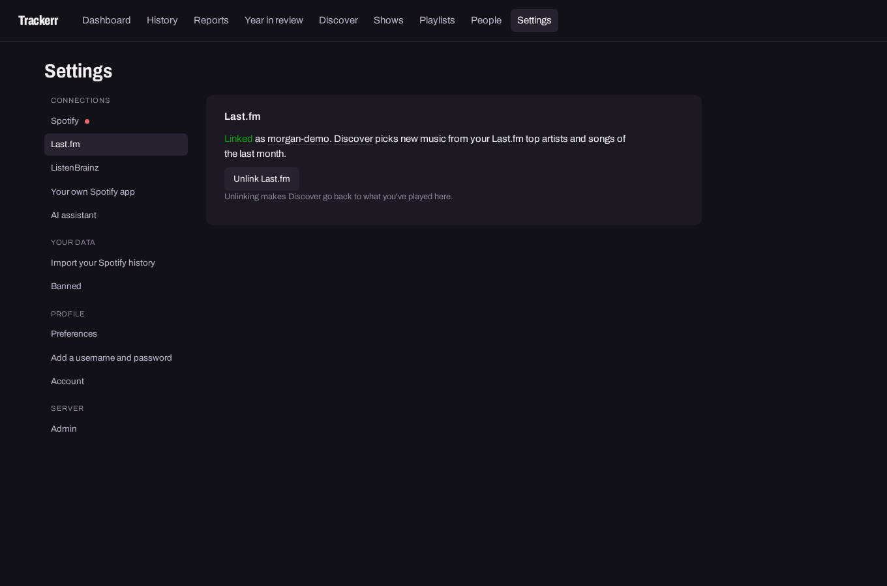
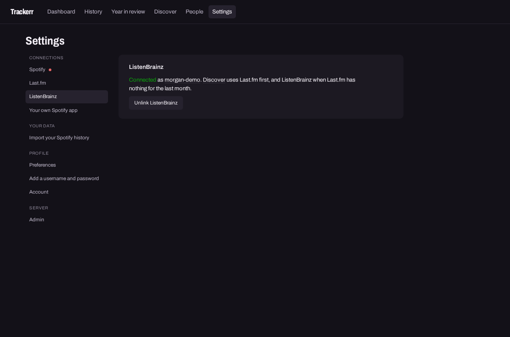
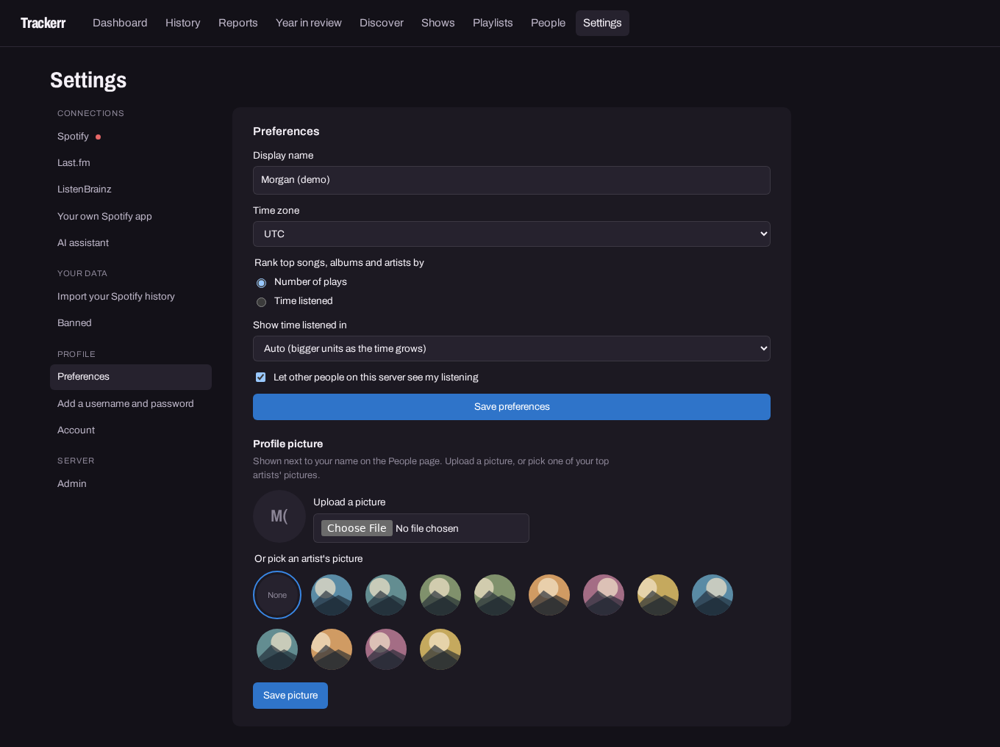
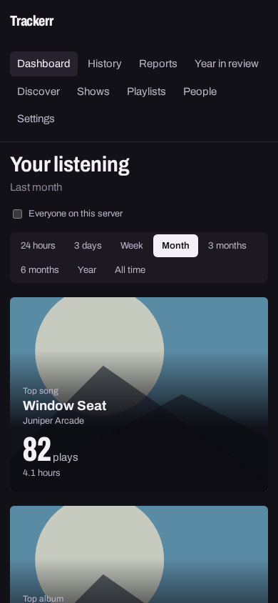

# Spotify Trackerr

Self-hosted Spotify listening history, stats, and music discovery for you and a few friends.
See your top songs, albums, artists, and genres; explore how your listening changes over time;
and revisit any year's music. New plays sync from Spotify every 5 minutes, and Spotify's
extended streaming history export fills in the past.

Optional Last.fm and ListenBrainz connections help Discover pick new music from more of your
listening. Your dashboards and history use the Spotify plays synced or imported into this app.



Screenshots show the current app with fictional artists, artwork, listening history, and
recommendation picks. No personal listening data or real connected accounts are shown.

## What you can do

- **Explore your listening.** Rank songs, albums, and artists by plays or minutes, from the last
  24 hours to all time. See trends, listening hours, genres, release decades, and album artwork.
  Choose minutes, hours, days, or months as the listening-time display unit in Settings.
- **Dig into a genre.** Click a genre on the dashboard or Year in Review to see its top song,
  album, and artist, plus top 10 lists for each. Keep the dashboard's time range or review year.
- **Search your history.** Search-as-you-type suggests songs, albums, and artists. Filter plays
  by date or month, and open a song, album, or artist to see its totals, first and last plays,
  monthly listening, and peak listening period.
- **Revisit a year.** Year in Review includes top fives, listening totals, a daily calendar,
  monthly charts, genres, and release years. It now lists your top 10 artists first heard that
  year and shows your biggest and quietest listening days. Quietest means the fewest plays on
  a day when you listened; days with no plays are excluded. “New to you” is based on the history
  stored here.
- **Find new music.** Discover offers artists, albums, and songs you haven't played in the app's
  recorded history, using Last.fm recommendations. Connect Last.fm or ListenBrainz in Settings
  to use your top artists and songs from those services; otherwise it uses your local history.
  Last.fm is preferred, with ListenBrainz and local history as fallbacks when needed.
- **Ban what you don't want to see.** Ban a song, album, or artist from its page and it
  disappears from your stats, top lists, charts, history, search, and recommendations. The plays
  stay saved: unban it from the page or from Settings → Banned and everything comes back.
- **Share with people on your server.** Make your listening visible to other signed-in users,
  browse their dashboards and histories through People, or view everyone's shared listening
  together. Visibility is controlled in Settings.
- **Manage your connections.** Settings has separate sections for Spotify, your own Spotify
  app, Last.fm, and ListenBrainz, alongside history import, preferences, and account controls.

Recent updates also improve all-time and year dashboard performance, handle Spotify rate limits
with a pause per developer app, and add automated build, browser, and security checks.

## Screenshots

<details>
<summary>Genre pages: top song, album, artist, and top 10 lists</summary>



</details>

<details>
<summary>Year in Review: artists new to you, biggest day, and quietest listening day</summary>



[See the full Year in Review](docs/screenshots/year-in-review.png).

</details>

<details>
<summary>Discover: artist, album, and song recommendations</summary>



</details>

<details>
<summary>Listening history and individual music pages</summary>





See the [artist](docs/screenshots/artist.png), [album](docs/screenshots/album.png), and
[top artists](docs/screenshots/top-artists.png) pages too.

</details>

<details>
<summary>Settings: Last.fm and ListenBrainz connections</summary>





</details>

<details>
<summary>Preferences: rankings, listening-time units, and visibility</summary>



</details>

<details>
<summary>Phone layout</summary>



</details>

Also see the [complete dashboard](docs/screenshots/dashboard.png),
[all-time dashboard](docs/screenshots/dashboard-all-time.png), and [People](docs/screenshots/people.png).
To refresh these images, see [the screenshot instructions](docs/screenshots/README.md).

## Run it

```sh
cp .env.example .env      # fill it in (see below)
docker compose up -d --build
tailscale serve --bg --https=8447 http://127.0.0.1:3457
```

Once you have a Cloudflare tunnel token in `.env`, add the tunnel with
`docker compose --profile tunnel up -d`.

Open https://hermes.tail36fb9.ts.net:8447. The first account you create is the admin.

If a device says the name can't be found, its Tailscale DNS is off. Turn on *Use Tailscale DNS* in
its Tailscale app (and switch off Chrome's *Use secure DNS*), or use http://100.100.64.121:8448
(set `TAILSCALE_IP` and add that address to `ALLOWED_HOSTS`). Spotify sign-in only works from the
https name.

## Setup checklist

1. **Spotify app.** At https://developer.spotify.com/dashboard create an app (Web API), add both
   redirect URIs from `.env.example`, and copy the Client ID and secret into `.env`. Your account
   must have Premium. Under *User Management*, add the Spotify accounts of everyone who will use it
   (Spotify allows 5 per app). More people? Each can create their own app and paste it into
   *Settings > Your own Spotify app*.
2. **Cloudflare Tunnel.** Create a tunnel in Cloudflare Zero Trust, give it a public hostname
   that points to `http://app:3000`, and put the token in `CLOUDFLARE_TUNNEL_TOKEN`. Add that
   hostname to `ALLOWED_HOSTS` and as a Spotify redirect URI, then run
   `docker compose --profile tunnel up -d`.
3. **Last.fm (optional).** Create a free app at https://www.last.fm/api/account/create and paste its
   API key and shared secret into *Settings > Last.fm* as an admin (or put them in `LASTFM_API_KEY`
   and `LASTFM_SHARED_SECRET`, which take priority). That turns on Discover
   (new artists, albums and songs), similar songs/artists and better genres, and lets each person
   *Sign in with Last.fm* in Settings so Discover works from their Last.fm top artists and songs.
   Discover and similar-music recommendations require the Last.fm API key; sign-in also needs
   the shared secret.
4. **ListenBrainz (optional).** For *Sign in with ListenBrainz*, register a web app at https://musicbrainz.org/account/applications
   with callback `https://<your address>/auth/listenbrainz/callback` and put its ID and secret in
   `MUSICBRAINZ_CLIENT_ID` and `MUSICBRAINZ_CLIENT_SECRET`. Each person can then connect their
   MusicBrainz account in *Settings > ListenBrainz*. Discover still requires the Last.fm API key
   to generate recommendations. Connecting either service does not import its plays into your
   listening history.
5. **Import history.** Request *Extended streaming history* at https://www.spotify.com/account/privacy/
   and upload the zip in Settings when it arrives (up to 30 days).

Spotify ends each link 6 months after sign-in. The app warns two weeks ahead; click
*Reconnect Spotify* to renew.

## How it counts

- A play counts if it lasted 30 seconds or the song finished. Private sessions, podcasts and
  audiobooks are left out.
- Re-importing is safe. A play from a different source (import vs. live sync) within 3 minutes
  (or the song's length, if longer) of an existing play is treated as the same play.
- Plays credit the song's main artist.
- Artwork comes from Deezer (iTunes as fallback), genres from Spotify then Last.fm, both looked up
  in the background, most-played first.

## Develop

```sh
npm install
npm run dev     # http://127.0.0.1:5173
npm test
npm run check
```

GitHub Actions runs tests, type checks, browser smoke tests, dependency/security scans, and Docker checks.
See [.github/README.md](.github/README.md) for local commands, schedules, and repository settings.

## Data and backups

Data lives in SQLite at `$DATA_DIR/trackerr.db` (`./data` by default, mounted at `/data` in Docker).
Spotify credentials, linked Last.fm session keys, and secrets pasted into Settings are encrypted
with `$DATA_DIR/secret.key`. Back up the key with the database; without it, affected connections
need to be reconnected and saved app credentials entered again. Keep your `.env` configuration
backed up separately.
